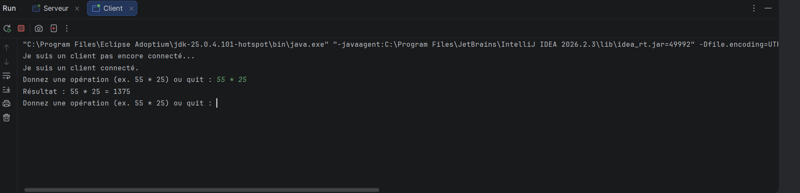
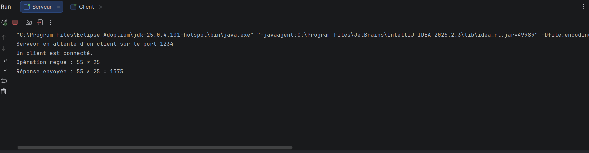

# TP 2 — Activité 2-1 : Échange d’opérations avec les sockets TCP

**Nom et prénom :** [À compléter]  
**Classe :** LSI 3  
**Matière :** Développement d’applications réparties  
**Environnement :** IntelliJ IDEA, Java [version utilisée]

## 1. Partie Serveur

Le serveur attend la connexion d’un client sur le port `1234`. Il reçoit séparément le premier opérande, l’opérateur et le deuxième opérande. Il calcule ensuite le résultat et l’envoie au client.

Pour effectuer le calcul, le serveur prend en charge les opérateurs `+`, `-`, `*` et `/`. Il renvoie aussi un message d’erreur si les opérandes ne sont pas valides ou si la division par zéro est demandée.


## 2. Partie Client

Le client demande à l’utilisateur de saisir une opération complète, par exemple `55 * 25`. Il vérifie sa syntaxe avant de l’envoyer. Si elle est correcte, le client sépare l’opération en trois éléments et les envoie au serveur : le premier opérande, l’opérateur et le deuxième opérande.

Le client lit ensuite la réponse du serveur et l’affiche dans la console.


## 3. Démarrage des applications et résultat

Lancer d’abord la classe `Serveur` dans IntelliJ IDEA. Le serveur doit rester actif et attendre la connexion.

Lancer ensuite la classe `Client`. Saisir l’opération suivante dans sa console :

```text
55 * 25
```

Le client envoie les trois éléments au serveur :

```text
55
*
25
```

Le serveur calcule le résultat et le renvoie au client. Le résultat attendu est :

```text
55 * 25 = 1375
```





## 4. Autres opérations

Les opérations prises en charge sont :

| Opération | Résultat attendu |
|---|---:|
| `10 + 3` | `13` |
| `10 - 3` | `7` |
| `10 * 3` | `30` |
| `10 / 4` | `2.5` |

Une saisie incorrecte, comme `25 ** 55` ou `abc + 3`, est rejetée par le client. La division par zéro, comme `10 / 0`, renvoie un message d’erreur.

## 5. Conclusion

Cette activité met en œuvre une communication client/serveur avec les sockets TCP en Java. Le client envoie une opération composée de deux opérandes et d’un opérateur. Le serveur effectue le calcul et renvoie le résultat au client.

---

# Activité 2-2 — Échange d’objets avec les sockets TCP

## Partie Serveur

La classe `Server` attend la connexion d’un client sur le port `1234`. Elle reçoit un objet `Operation`, récupère ses deux opérandes et son opérateur, effectue le calcul, puis renvoie le résultat au client sous la forme d’un objet.

La classe `Operation` implémente `Serializable`. Cette interface permet de transmettre l’objet Java à travers la socket.


## Partie Client

La classe `Client` propose un menu pour choisir une opération. Elle demande les deux nombres, crée un objet `Operation` et l’envoie au serveur avec `ObjectOutputStream`. Elle lit ensuite la réponse avec `ObjectInputStream` et l’affiche.


## Démarrage et résultat

Lancer d’abord `Server` dans IntelliJ IDEA et le laisser actif. Lancer ensuite `Client`.

Pour tester la multiplication :

1. Choisir `3` dans le menu.
2. Saisir `55` comme premier nombre.
3. Saisir `25` comme deuxième nombre.

Le résultat attendu côté client est :

```text
Résultat reçu du serveur : 1375.0